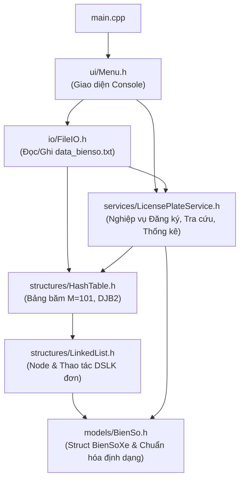

# Báo Cáo Dự Án – Phần Của Thành Viên 1 (Nhóm Trưởng & Kiến Trúc Sư)

> **Phạm vi phụ trách:** Mục 1 (Giới thiệu đề tài) & Mục 3 (Thiết kế giải pháp) theo quy định tại `Bai tap Du An - CTDLGT.pdf`.

---

## 1. GIỚI THIỆU ĐỀ TÀI

### 1.1 Bối cảnh bài toán
Trong công tác quản lý phương tiện giao thông đường bộ, mỗi phương tiện được cấp một biển số định danh duy nhất gắn liền với địa phương đăng ký (Tỉnh/Thành phố và Quận/Huyện/Xã/Phường) cùng số seri thứ tự. Khi số lượng phương tiện tăng lên hàng chục nghìn đến hàng triệu bản ghi, việc lưu trữ bằng mảng tuần tự hoặc danh sách liên kết đơn thuần sẽ dẫn đến chi phí kiểm tra trùng lặp và tra cứu tốn thời gian tuyến tính $O(N)$, gây nghẽn cổ chai trong các tác vụ tra cứu thời gian thực.

**Đề tài 11 – Hệ thống quản lý biển số xe** giải quyết bài toán lưu trữ, đăng ký, tra cứu nhanh và thống kê biển số xe theo đơn vị hành chính (Tỉnh/Xã) bằng cách kết hợp **Bảng băm (Hash Table)** theo phương pháp **Kết nối trực tiếp (Separate Chaining)** với **Danh sách liên kết đơn (Singly Linked List)**.

### 1.2 Mục tiêu của hệ thống
1. **Về mặt nghiệp vụ:**
   - Quản lý biển số xe chuẩn hóa theo định dạng `ab-cd-ghxyz` (`ab`: 2 chữ số mã Tỉnh; `cd`: 2 ký tự chữ/số mã Xã; `ghxyz`: 5 chữ số seri).
   - Cung cấp 5 nhóm chức năng cốt lõi: Đăng ký biển số mới (có kiểm tra định dạng và chống trùng lặp), Tra cứu nhanh biển số, Liệt kê danh sách mã Xã thuộc một Tỉnh, Liệt kê danh sách biển số thuộc một Xã của Tỉnh, và Đọc/Ghi dữ liệu bền vững qua tệp văn bản (`data/data_bienso.txt`).
2. **Về mặt Cấu trúc dữ liệu và Giải thuật:**
   - Thiết kế và hiện thực từ đầu (from scratch) cấu trúc `HashTable` kết hợp `LinkedList` trong C++17, không phụ thuộc vào `std::unordered_map` hay `std::list` có sẵn của STL.
   - Đạt độ phức tạp trung bình $O(1 + \alpha)$ cho thao tác đăng ký, tra cứu và xóa biển số, đồng thời đảm bảo an toàn bộ nhớ (không rò rỉ vùng nhớ động qua cơ chế RAII).

### 1.3 Phạm vi thực hiện
- **Ngôn ngữ & Chuẩn biên dịch:** C++17 (`g++ -std=c++17 -Wall -Wextra -pedantic`).
- **Giao diện:** Giao diện dòng lệnh (Console UI) tương tác qua Menu.
- **Lưu trữ:** Tệp văn bản thuần (`data/data_bienso.txt`), tự động chuẩn hóa và bỏ qua các dòng dữ liệu lỗi khi nạp.

---

## 3. THIẾT KẾ GIẢI PHÁP

### 3.1 Thiết kế Mô hình Dữ liệu (`BienSoXe` và `Node`)

Mỗi biển số xe được mô hình hóa bởi cấu trúc `BienSoXe` tại `src/models/BienSo.h`:

```cpp
struct BienSoXe {
    std::string maTinh;   // 2 chữ số (ví dụ: "29", "51")
    std::string maXa;     // 2 ký tự chữ/số, chuẩn hóa in hoa (ví dụ: "A1", "H3")
    std::string seri;     // 5 chữ số (ví dụ: "12345")

    std::string toString() const {
        return maTinh + "-" + maXa + "-" + seri; // Khóa chính: "29-A1-12345" (11 ký tự)
    }
};
```

Để phục vụ giải quyết đụng độ (collision) trên bảng băm bằng danh sách liên kết đơn, mỗi phần tử trong chuỗi va chạm được biểu diễn bởi cấu trúc `Node` tại `src/structures/LinkedList.h`:

```cpp
struct Node {
    BienSoXe data;
    Node* next;

    explicit Node(const BienSoXe& value) : data(value), next(nullptr) {}
};
```

### 3.2 Lựa chọn Cấu trúc Dữ liệu: Tại sao chọn Hash Table (Separate Chaining)?

Khi đặt lên bàn cân các cấu trúc dữ liệu trong học phần:

| Tiêu chí | Mảng / DSLK đơn | Cây tìm kiếm nhị phân (BST / AVL) | Bảng băm (Separate Chaining) |
| :--- | :--- | :--- | :--- |
| **Tra cứu 1 biển số** | $O(N)$ | $O(\log N)$ | **Trung bình $O(1 + \alpha)$** |
| **Đăng ký (kiểm tra trùng + chèn)** | $O(N)$ | $O(\log N)$ | **Trung bình $O(1 + \alpha)$** |
| **Xử lý khi số lượng vượt dự kiến** | Cấp phát lại (Mảng) / Tự co giãn (DSLK) | Tự co giãn theo node | **Co giãn linh hoạt nhờ DSLK tại mỗi bucket, không bị tràn bảng như Open Addressing** |
| **Duyệt thống kê theo Tỉnh/Xã** | $O(N)$ | $O(N)$ | **$O(M + N)$** |

**Lý do chọn Separate Chaining (Kết nối trực tiếp) thay vì Open Addressing (Địa chỉ mở / Linear Probing):**
1. **Không bị giới hạn cứng hệ số tải ($\alpha > 1$ vẫn hoạt động ổn định):** Với Open Addressing, khi số biển số $N$ tiến sát kích thước bảng $M$, hiện tượng gom cụm sơ cấp (Primary Clustering) làm hiệu năng suy giảm nghiêm trọng và không thể chèn thêm khi $N > M$ nếu không rehash. Ngược lại, với Separate Chaining, mỗi bucket là một con trỏ `Node*` quản lý một danh sách liên kết đơn nên có thể lưu trữ số lượng biển số lớn tùy ý.
2. **Thao tác xóa (`remove`) đơn giản và chính xác:** Trong Open Addressing, xóa một phần tử đòi hỏi đánh dấu trạng thái *Tombstone (Lazy Deletion)* để không làm đứt gãy chuỗi dò tìm. Trong Separate Chaining, ta chỉ cần tháo nút (`Node`) ra khỏi danh sách liên kết và giải phóng bộ nhớ `delete current;`.

### 3.3 Thiết kế Hàm băm (Hash Function) và Kích thước bảng $M = 101$

#### a) Công thức hàm băm DJB2
Hệ thống sử dụng hàm băm **DJB2** (do Daniel J. Bernstein đề xuất) băm trên chuỗi khóa chuẩn hóa `ab-cd-ghxyz` (độ dài cố định $L = 11$):
- Giá trị khởi tạo: $\text{hash}_0 = 5381$.
- Với mỗi ký tự $c_i$ trong chuỗi khóa:
  $$\text{hash}_i = (\text{hash}_{i-1} \times 33) + c_i = ((\text{hash}_{i-1} \ll 5) + \text{hash}_{i-1}) + c_i$$
- Chỉ số bucket:
  $$\text{index} = \text{hash}_L \bmod M \quad (M = 101)$$

#### b) So sánh DJB2 với Polynomial Rolling Hash
- **Polynomial Rolling Hash** ($\sum c_i \cdot p^i \bmod M$, thường chọn $p = 31$ hoặc $53$) và **DJB2** thực chất có cùng bản chất toán học là đa thức bậc $L$ với cơ số $p = 33$ và hằng số khởi tạo $5381$ (một số nguyên tố có phân bố bit tốt).
- Ưu điểm của DJB2 là phép nhân với $33$ được tối ưu hóa ở mức phần cứng thành phép dịch bit trái `((hash << 5) + hash)`, vừa nhanh vừa khuếch tán tốt sự khác biệt chỉ 1 ký tự ở phần số seri (`ghxyz`) hoặc mã xã (`cd`).

#### c) Lý do chọn $M = 101$
- $101$ là một **số nguyên tố** (prime number) không nằm gần lũy thừa của $2$ hay $10$. Khi chia lấy dư ($\bmod\ 101$), các khóa biển số có quy luật thập phân (như seri tăng dần `12345`, `12346`, `12347`) sẽ được phân tán đều ra các bucket khác nhau, hạn chế tối đa đụng độ (collision).

### 3.4 Kiến trúc Tổ chức Chương trình (Layered Architecture)



### 3.5 Phân tích Độ phức tạp Thuật toán & Quản lý Bộ nhớ

Gọi $N$ là tổng số biển số xe hiện có trong hệ thống, $M = 101$ là số bucket của bảng băm, $L = 11$ là độ dài cố định của chuỗi biển số `ab-cd-ghxyz`, và $\alpha = \frac{N}{M}$ là hệ số tải (Load Factor):

| Thao tác / Hàm | Độ phức tạp Thời gian (Trung bình) | Độ phức tạp Thời gian (Xấu nhất) | Độ phức tạp Không gian phụ | Giải thích |
| :--- | :---: | :---: | :---: | :--- |
| `parseBienSo` / `hashFunction` | $O(1)$ | $O(1)$ | $O(1)$ | Chuỗi biển số có độ dài cố định $L = 11$ ký tự. |
| `HashTable::insert` (`registerPlate`) | $O(1 + \alpha)$ | $O(N)$ | $O(1)$ | Băm khóa $O(1)$, duyệt bucket kiểm tra trùng trung bình $\alpha$ nút, chèn đầu DSLK (`insertFront`) $O(1)$. |
| `HashTable::find` (`searchPlate`) | $O(1 + \alpha)$ | $O(N)$ | $O(1)$ | Băm khóa $O(1)$, tìm tuyến tính trên chuỗi liên kết của 1 bucket có độ dài trung bình $\alpha$. |
| `HashTable::remove` | $O(1 + \alpha)$ | $O(N)$ | $O(1)$ | Băm khóa $O(1)$, tìm và xóa nút trong bucket tương ứng. |
| `getCommuneCodesByProvince` | $O(M + N + K^2)$ | $O(M + N + K^2)$ | $O(K)$ | Duyệt $M$ bucket và $N$ nút; kiểm tra trùng trên tập $K$ mã xã thuộc tỉnh ($K \le N$). |
| `getPlatesByCommune` | $O(M + N)$ | $O(M + N)$ | $O(P)$ | Duyệt toàn bộ $M$ bucket và $N$ nút để thu thập $P$ biển số khớp cả mã tỉnh và mã xã. |
| **Tổng bộ nhớ lưu trữ** | $O(M + N)$ | $O(M + N)$ | — | Mảng tĩnh $M$ con trỏ `Node*` và $N$ đối tượng `Node` cấp phát động trên Heap. |

**Cơ chế an toàn bộ nhớ (Memory Ownership & RAII):**
- Lớp `HashTable` nắm quyền sở hữu độc quyền đối với toàn bộ các `Node` được cấp phát bằng `new` trong các bucket.
- Hàm hủy `~HashTable()` tự động gọi `clear()`, duyệt qua cả $M = 101$ bucket và gọi `LinkedList::clear(table[i])` để `delete` từng `Node`, triệt tiêu hoàn toàn nguy cơ rò rỉ bộ nhớ (Memory Leak).
- Copy Constructor và Copy Assignment Operator được vô hiệu hóa (`= delete`) nhằm ngăn chặn lỗi sao chép nông (Shallow Copy) gây giải phóng vùng nhớ hai lần (Double Free).
