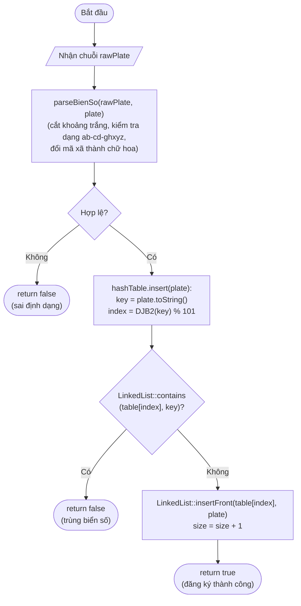
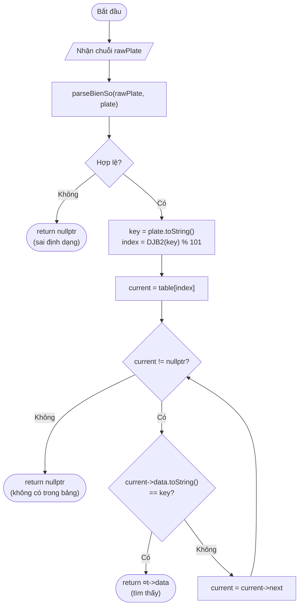

# Báo Cáo Dự Án – Phần Của Thành Viên 2 (Kỹ Sư Thuật Toán Core)

> **Thành viên thực hiện:** Trầm Hoài Nghĩa (TV2)  
> **Phạm vi phụ trách:** Mục 2 (Phân tích bài toán & Sơ đồ thuật toán Chèn / Tìm kiếm) và hiện thực module `src/structures/LinkedList.h`.

---

## 2. PHÂN TÍCH BÀI TOÁN

### 2.1 Bài toán cần giải
Hệ thống của nhóm quản lý biển số xe có dạng `ab-cd-ghxyz`, ví dụ `29-A1-12345`. Dữ liệu được đặt trong bảng băm `101` bucket, hàm băm **DJB2**, mỗi bucket là một danh sách liên kết đơn (**Separate Chaining**). Phần Thành viên 2 phụ trách gồm danh sách liên kết đơn dùng làm bucket (`src/structures/LinkedList.h`), cùng hai chức năng cốt lõi đầu tiên của chương trình là **đăng ký biển số mới** (`registerPlate`) và **tra cứu một biển số** (`searchPlate`).

Yêu cầu quan trọng nhất của phần này là mỗi biển số chỉ được xuất hiện **đúng một lần** trong hệ thống. Vì vậy trước khi thêm mới, hệ thống phải đảm bảo chuỗi nhập vào đúng định dạng và chưa tồn tại trong bảng băm. Việc kiểm tra trùng được thực hiện tại `HashTable::insert` thông qua hàm `LinkedList::contains`, còn `LicensePlateService::registerPlate` chịu trách nhiệm kiểm tra và chuẩn hóa định dạng bằng `parseBienSo` trước khi gọi `insert`.

### 2.2 Dữ liệu vào (Input)

| Dữ liệu | Kiểu | Quy cách / Ghi chú |
| :--- | :--- | :--- |
| `rawPlate` | `std::string` | Biển số do người dùng gõ ở Menu hoặc đọc từ một dòng trong file TXT. Có thể thừa khoảng trắng hai đầu, mã xã có thể gõ chữ thường. |
| `ab` (mã tỉnh) | 2 ký tự | Đúng 2 chữ số (`00` – `99`). |
| `cd` (mã xã) | 2 ký tự | Chữ cái hoặc chữ số (`std::isalnum`). Chương trình tự đổi sang chữ in hoa nên `a1` và `A1` là một. |
| `ghxyz` (seri) | 5 ký tự | Đúng 5 chữ số (`00000` – `99999`). |
| Hai dấu `-` | 1 ký tự | Nằm cố định ở vị trí chỉ số `2` và `5` (đếm từ `0`). Tổng độ dài chuỗi sau khi cắt khoảng trắng đúng bằng **11 ký tự**. |

### 2.3 Dữ liệu ra (Output)
- **`registerPlate(rawPlate)`**: Trả về `true` khi biển số hợp lệ và chưa tồn tại trong bảng; khi đó `Node` mới được chèn vào đầu bucket (`LinkedList::insertFront`) và tổng số phần tử `size` tăng thêm `1`. Trả về `false` nếu sai định dạng hoặc trùng biển số (bảng băm giữ nguyên trạng thái).
- **`searchPlate(rawPlate)`**: Trả về con trỏ hằng `const BienSoXe*` trỏ trực tiếp tới dữ liệu trong `Node` của bảng băm nếu tìm thấy; trả về `nullptr` nếu sai định dạng hoặc không tồn tại. Con trỏ trả về chỉ dùng để đọc, tuyệt đối không gọi `delete` từ bên ngoài.
- **Các hàm của `LinkedList`**:
  - `contains(head, plate)` và `remove(head, plate)`: Trả về `bool`.
  - `insertFront(head, value)` và `clear(head)`: Kiểu `void`, nhận tham chiếu con trỏ `Node*& head` nên cập nhật trực tiếp con trỏ đầu bucket ngay tại chỗ gọi.
  - `print(head)`: Duyệt và in từng biển số trong chuỗi liên kết của bucket ra màn hình.

### 2.4 Ngoại lệ và Trường hợp biên (Boundary & Invalid Cases)

| Trường hợp | Ví dụ | Cách xử lý |
| :--- | :--- | :--- |
| Chuỗi rỗng hoặc chỉ có khoảng trắng | `""`, `"   "` | Sau khi `trimCopy` cắt khoảng trắng, độ dài khác `11` nên bị từ chối (`false`). |
| Sai độ dài | `29-A1-1234` | Từ chối ngay ở bước kiểm tra `value.size() != 11`. |
| Thiếu hoặc sai dấu gạch ngang | `29A1-12345`, `29_A1_12345` | Từ chối vì ký tự ở vị trí `2` và `5` không phải `'-'`. |
| Mã tỉnh không phải chữ số | `A9-A1-12345` | Từ chối tại `parseMaTinh`. |
| Mã xã có ký tự đặc biệt | `29-A!-12345` | Từ chối tại `parseMaXa` (`!std::isalnum`). |
| Seri chứa chữ cái hoặc quá dài | `29-A1-1234B`, `29-A1-123456` | Từ chối tại bước kiểm tra `isDigits(parsed.seri)` hoặc độ dài. |
| Thừa khoảng trắng hai đầu | `" 29-A1-12345 "` | Vẫn hợp lệ vì được `trimCopy` cắt bỏ khoảng trắng trước khi kiểm tra. |
| Mã xã viết chữ thường | `29-a1-12345` | Chuẩn hóa tự động thành `29-A1-12345`; nếu đã có `29-A1-12345` thì tính là trùng. |
| Đăng ký trùng lặp | Đăng ký `29-A1-12345` hai lần | Lần thứ hai `LinkedList::contains` trả về `true` $\rightarrow$ `insert` trả về `false`, không cấp phát thêm `Node`. |
| Tra cứu biển số không tồn tại | `99-ZZ-99999` | Duyệt hết bucket không khớp $\rightarrow$ trả về `nullptr`. |
| Danh sách rỗng (`head == nullptr`) | Gọi `contains`, `remove`, `clear` khi bucket trống | An toàn tuyệt đối: điều kiện `current != nullptr` dừng ngay, không truy cập con trỏ `nullptr`. |
| Xóa `Node` ở đầu, giữa, cuối bucket | `remove` ở các vị trí khác nhau | Nếu xóa `Node` đầu (`prev == nullptr`) thì cập nhật `head = current->next`; các vị trí còn lại nối `prev->next = current->next` rồi `delete current`. |

> **Ghi chú thiết kế API:** `registerPlate` trả về kiểu `bool` thống nhất cho cả trường hợp sai định dạng lẫn trùng biển số. Nhóm đã thống nhất giữ nguyên chữ ký `bool registerPlate(const std::string& rawPlate)` theo đúng hợp đồng tích hợp tại `docs/THONG_NHAT_API.md` để đảm bảo tính đóng gói và tương thích đồng bộ với `FileIO::loadFromFile`.

---

### 2.5 Sơ đồ thuật toán Chèn và Tìm kiếm

#### 2.5.1 Thuật toán Chèn (Đăng ký biển số – `registerPlate` & `HashTable::insert`)

- **Giải thích:** Sơ đồ gồm hai cổng kiểm tra. Nếu sai định dạng ở `parseBienSo` thì dừng ngay và trả về `false`. Nếu hợp lệ, `HashTable::insert` tạo khóa chuẩn hóa `key = plate.toString()`, băm bằng hàm **DJB2** lấy chỉ số bucket `index = DJB2(key) % 101` rồi gọi `LinkedList::contains` duyệt chuỗi liên kết tại `table[index]`. Nếu khóa đã tồn tại thì từ chối (`return false`); nếu chưa tồn tại thì cấp phát `Node` mới và chèn vào đầu danh sách bằng `LinkedList::insertFront` trong thời gian $O(1)$.
- **Độ phức tạp:** Trung bình $O(L + \alpha) = O(1 + \alpha)$ với $L = 11$ là độ dài chuỗi cố định và $\alpha = \frac{N}{101}$; trường hợp xấu nhất $O(N)$ khi mọi biển số va chạm vào cùng một bucket.

#### 2.5.2 Thuật toán Tìm kiếm (Tra cứu biển số – `searchPlate` & `HashTable::find`)

- **Giải thích:** Thao tác tra cứu cũng chuẩn hóa chuỗi đầu vào bằng `parseBienSo` trước tiên, nhờ đó người dùng gõ `51-b2-00000` (chữ thường) vẫn tìm ra đúng bản ghi `51-B2-00000`. Sau khi tính chỉ số `index = DJB2(key) % 101`, thuật toán chỉ cần duyệt tuyến tính trên đúng một danh sách liên kết tại `table[index]` thay vì quét toàn bộ bảng.
- **Độ phức tạp:** Trung bình $O(L + \alpha) = O(1 + \alpha)$, trường hợp xấu nhất $O(N)$.
